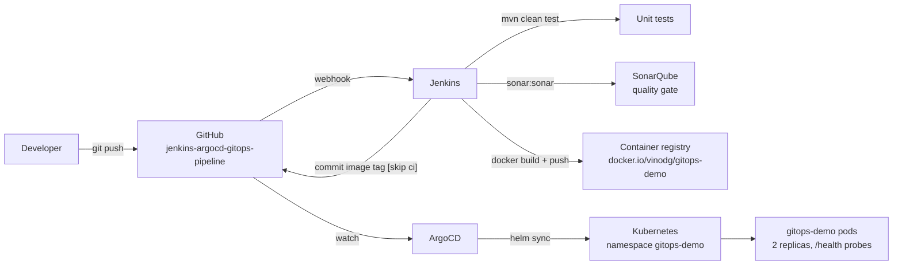
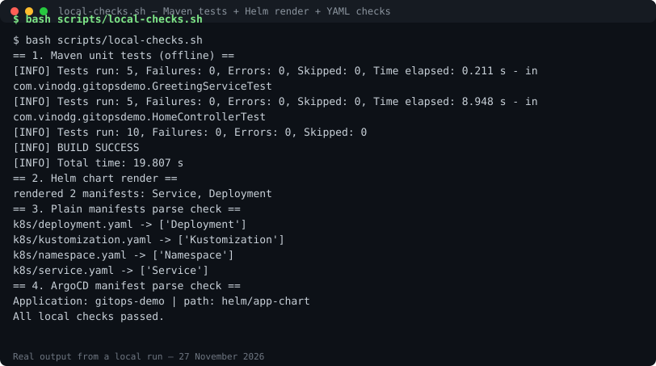
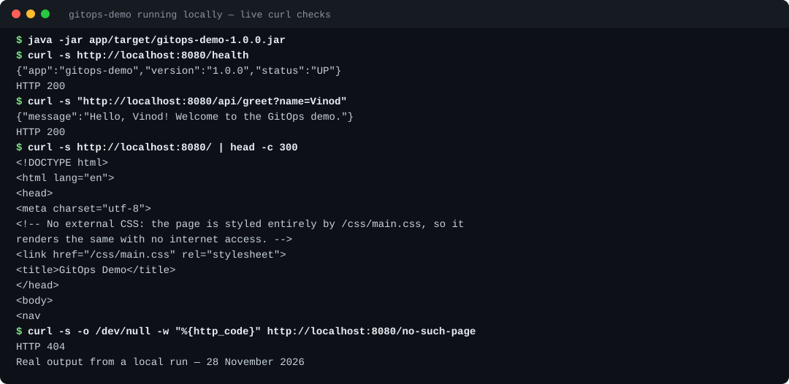
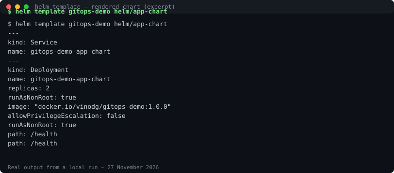

# Jenkins + SonarQube + ArgoCD GitOps Pipeline


> **Push code → Jenkins builds, tests and scans it → the image tag is
> committed back to Git → ArgoCD deploys whatever Git says.** No manual
> deploys, no drift: the cluster always matches the Git history.

## Overview

The application is a small Spring Boot web service (`gitops-demo`) with a
welcome page, a JSON greeting API and a `/health` endpoint. The pipeline
around it is the real subject of this repository:

1. A push to `main` triggers the Jenkins pipeline.
2. Jenkins runs `mvn clean test`, then a SonarQube analysis with a quality
   gate. A failing gate stops the pipeline.
3. Jenkins builds a Docker image, tags it with the git short SHA and pushes
   it to the container registry.
4. Jenkins updates the image tag in `helm/app-chart/values.yaml` and commits
   it back with `[skip ci]` in the message, so the tag commit does not
   trigger another build.
5. ArgoCD watches this repository, sees the new tag and syncs it into the
   cluster automatically (prune + self-heal enabled).

## Architecture



```text
Developer ──push──> GitHub ──webhook──> Jenkins ──test + scan──> SonarQube
                                                        │
                                              docker build + push
                                                        │
                                                        v
                                        Container registry (docker.io/vinodg)
                                                        │
Jenkins ──commit image tag [skip ci]──> GitHub ──watch──> ArgoCD ──sync──> Kubernetes
```

## CI/CD workflow

| Stage | What happens | Fails the build when |
|---|---|---|
| Build and Test | `mvn -f app/pom.xml clean test` | Any unit test fails |
| SonarQube Analysis | `mvn sonar:sonar` against the `sonarqube` server | Scanner cannot reach SonarQube |
| Quality Gate | `waitForQualityGate`, 5 minute timeout | Quality gate is red |
| Docker Build and Push | Image tagged with the git short SHA, pushed to the registry | Docker build or push fails |
| Update GitOps Manifests | Image tag in `helm/app-chart/values.yaml` updated and committed as `[skip ci]` | The push is rejected |

### Preventing build loops

The manifest-update commit must never start another build, or the pipeline
would loop forever. Two guards are in place, and both are needed:

1. **The commit message.** The tag commit is made with `[skip ci]` in the
   message. Every stage in the `Jenkinsfile` is guarded by
   `when { not { changelog '.*\\[skip ci\\].*' } }`, so a build triggered by
   that commit does nothing.
2. **Path filtering on the job.** The Jenkins job should ignore
   manifest-only changes. In a multibranch or GitHub Organisation job, add
   the "Polling ignores commits in certain paths" behaviour (or the
   equivalent "Included regions" setting) with these excluded regions:
   `helm/.*`, `k8s/.*`, `argocd/.*` — so the pipeline only triggers on
   changes under `app/` (and the `Jenkinsfile` itself). If your Jenkins
   version has no such behaviour, guard (1) is the safety net.

## GitOps, in short

GitOps means the Git repository is the single source of truth for what runs
in the cluster. Nobody applies manifests by hand. The flow here is:

- Desired state lives in this repo: `helm/app-chart/` (the chart ArgoCD
  syncs) and `k8s/` (plain manifests, an alternative for clusters without
  Helm).
- Jenkins is the only writer of the image tag. It never talks to the
  cluster.
- ArgoCD is the only reader that talks to the cluster. It compares the
  live cluster state with Git and fixes any drift (self-heal), and removes
  resources that were deleted from Git (prune).
- To roll back, revert the image tag commit in Git. ArgoCD syncs the old
  tag and the previous image runs again. See
  [Rollback](#rollback) below.

## Tech stack

| Layer | Choice |
|---|---|
| Language | Java 17 |
| Framework | Spring Boot 3.4.1 (web + Thymeleaf) — pinned for offline reproducibility; the current stable line is 4.2.0 (Nov 2026), and the upgrade is tracked separately, not silently applied |
| Build | Maven 3.9 |
| Tests | JUnit 5, Spring Boot Test, MockMvc |
| Code quality | SonarQube (sonar-maven-plugin 4.0.0.4121) |
| CI | Jenkins declarative pipeline |
| Container | Docker, multi-stage build, Temurin 21 |
| Kubernetes | Plain manifests + Helm chart (apiVersion v2; works with Helm 3 and 4) |
| GitOps | ArgoCD Application, automated sync |
| Registry | Docker Hub (`docker.io/vinodg/gitops-demo`) |

## Repository structure

```text
.
├── Jenkinsfile                 # Declarative pipeline (build, scan, push, tag update)
├── Dockerfile                  # Multi-stage build, non-root user, /health check
├── .dockerignore
├── .gitignore
├── app/                        # Spring Boot application (Maven)
│   ├── pom.xml
│   └── src/
│       ├── main/java/com/vinodg/gitopsdemo/
│       │   ├── GitopsDemoApplication.java   # Entry point
│       │   ├── GreetingService.java         # Business logic (unit tested)
│       │   ├── HomeController.java          # GET / welcome page
│       │   └── ApiController.java           # GET /health, GET /api/greet
│       ├── main/resources/
│       │   ├── application.properties       # server.port=8080
│       │   ├── templates/index.html         # Thymeleaf welcome page
│       │   └── static/css/main.css
│       └── test/java/com/vinodg/gitopsdemo/
│           ├── GreetingServiceTest.java     # 5 unit tests
│           └── HomeControllerTest.java      # 5 HTTP tests (MockMvc)
├── k8s/                       # Plain Kubernetes manifests (no Helm needed)
│   ├── namespace.yaml
│   ├── deployment.yaml         # 2 replicas, /health probes, resource limits
│   ├── service.yaml            # ClusterIP, port 80 -> 8080
│   └── kustomization.yaml
├── helm/app-chart/             # Helm chart (what ArgoCD syncs)
│   ├── Chart.yaml
│   ├── values.yaml             # image.repository/tag, replicaCount, probes
│   └── templates/
│       ├── deployment.yaml
│       ├── service.yaml
│       ├── _helpers.tpl
│       └── NOTES.txt
├── argocd/
│   ├── application.yaml        # ArgoCD Application (automated sync, prune, self-heal)
│   └── setup.md                # ArgoCD install and sync instructions
└── scripts/
    ├── local-checks.sh         # Runs mvn test + helm template + YAML checks locally
    ├── cleanup.sh              # Manual teardown (never auto-runs against a cluster)
    └── populate-maven-repo.py  # Populates a local Maven repo with curl (restricted networks)
```

## Prerequisites

- Java 17+ and Maven 3.9 (to build the app locally)
- Docker (to build the image)
- A Kubernetes cluster with Helm 3 or 4 and ArgoCD installed (to deploy)
- A Jenkins server with the plugins below, a SonarQube server, and a
  container registry account (Docker Hub by default)

## Jenkins configuration

### Plugins

- Git
- Pipeline (workflow-aggregator)
- Docker Pipeline (`docker-workflow`)
- SonarQube Scanner

### Global tools

- JDK 17 (name it `JDK 17` or update the pipeline)
- Maven 3.9

### Credentials (Manage Jenkins → Credentials)

| ID | Type | Used for |
|---|---|---|
| `docker-hub-credentials` | Username with password | Pushing the image to the registry |
| `github-credentials` | Username with password | Pushing the image-tag commit (GitHub username + personal access token) |

No credential is ever written in a file or in the `Jenkinsfile`. The
registry, namespace and image name are pipeline parameters (`REGISTRY`,
`IMAGE_NAMESPACE`, `IMAGE_NAME`) with Docker Hub defaults.

### SonarQube server

Add a SonarQube server in Jenkins (Manage Jenkins → System → SonarQube
servers) named **`sonarqube`**. The pipeline runs the analysis with
`withSonarQubeEnv('sonarqube')` and then waits for the quality gate. Point
`sonar.host.url` in `app/pom.xml` at your own server; the default
`http://localhost:9000` is only for a local SonarQube.

### Job trigger

Create a Pipeline job (or a multibranch job) pointing at
`https://github.com/vinod-codes/jenkins-argocd-gitops-pipeline.git`, branch
`main`, script path `Jenkinsfile`. Add a GitHub webhook on push to `main`,
and apply the path filtering described in
[Preventing build loops](#preventing-build-loops).

## Maven build

```bash
# From the repository root. Runs the unit tests, then packages the jar.
mvn -f app/pom.xml clean test
mvn -f app/pom.xml clean package -DskipTests
java -jar app/target/gitops-demo-1.0.0.jar
# The app listens on http://localhost:8080
#   /            welcome page
#   /health      {"status":"UP","app":"gitops-demo","version":"1.0.0"}
#   /api/greet?name=Vinod
```

## SonarQube configuration

```bash
# Against a running SonarQube server (default http://localhost:9000).
# The server URL and project key are set in app/pom.xml; override with
# -Dsonar.host.url=... -Dsonar.login=<token> as needed.
mvn -f app/pom.xml sonar:sonar
```

In Jenkins the token comes from the `sonarqube` server configuration, not
from a hardcoded value. The quality gate is enforced by the
`waitForQualityGate` step; a red gate stops the pipeline before any image
is built.

## Docker configuration

```bash
# Build (from the repository root; the build context is the repo root).
docker build -t docker.io/vinodg/gitops-demo:1.0.0 .

# Run locally.
docker run -d -p 8080:8080 --name gitops-demo docker.io/vinodg/gitops-demo:1.0.0
curl http://localhost:8080/health
```

The `Dockerfile` is a multi-stage build: a Maven image compiles the jar,
then a slim Temurin 21 JRE image runs it as a non-root user (`appuser`).
A `HEALTHCHECK` calls `/health` every 30 seconds.

## Kubernetes setup

### Option A — Helm (the ArgoCD path)

```bash
kubectl create namespace gitops-demo
helm install gitops-demo helm/app-chart --namespace gitops-demo
kubectl get pods -n gitops-demo
kubectl port-forward svc/gitops-demo-app-chart 8080:80 -n gitops-demo
curl http://localhost:8080/health
```

### Option B — plain manifests (no Helm)

```bash
kubectl apply -k k8s/
kubectl get pods -n gitops-demo
```

The Deployment runs 2 replicas with readiness and liveness probes on
`/health`, CPU/memory requests of 250m/256Mi and limits of 500m/512Mi. The
Service is ClusterIP, port 80 → container 8080.

## Helm explanation

`helm/app-chart/` is a standard chart:

- `Chart.yaml` — chart metadata (name `app-chart`, version 0.1.0,
  appVersion 1.0.0).
- `values.yaml` — the only file Jenkins ever edits: `image.repository`,
  `image.tag`, `replicaCount`, service type/ports, resources and probe
  timings.
- `templates/deployment.yaml` and `templates/service.yaml` — the manifests,
  rendered from the values above.
- `templates/NOTES.txt` — the message Helm prints after install.

Render it without a cluster to check it:

```bash
helm template gitops-demo helm/app-chart
```

## ArgoCD setup

See `argocd/setup.md` for the full steps. In short:

```bash
# Install ArgoCD (once per cluster).
kubectl create namespace argocd
kubectl apply -n argocd -f https://raw.githubusercontent.com/argoproj/argo-cd/stable/manifests/install.yaml

# Register this repository's Application.
kubectl apply -f argocd/application.yaml
```

`argocd/application.yaml` points ArgoCD at this repository
(`https://github.com/vinod-codes/jenkins-argocd-gitops-pipeline.git`),
path `helm/app-chart`, destination namespace `gitops-demo`, with
automated sync, `prune: true` and `selfHeal: true`. `CreateNamespace=true`
creates the namespace on first sync. From then on, every image-tag commit
Jenkins makes is deployed automatically, with no manual step.

## Deployment instructions

1. Push a change under `app/` to `main`.
2. Jenkins builds, tests, scans, builds the image and commits the new tag
   to `helm/app-chart/values.yaml`.
3. ArgoCD syncs the new tag into the cluster.
4. Verify: `kubectl rollout status deployment/gitops-demo-app-chart -n gitops-demo`
   and `curl` the `/health` endpoint.

> **Deployment status: this repository has not been deployed to a cluster
> yet.** No cluster, cloud account or registry push exists for this project
> as of writing. The pipeline, manifests and chart are written and
> locally validated (see [Testing](#testing)), and deployment evidence
> will be added here after the first real run.

## Rollback

**Preferred — revert in Git (GitOps way):**

```bash
# Find the tag commit to undo, then revert it.
git log --oneline -- helm/app-chart/values.yaml
git revert <commit-sha>
git push origin main
# ArgoCD syncs the previous image tag automatically.
```

**Alternative — in the cluster (breaks the GitOps rule, use only to stop
an incident, then fix Git to match):**

```bash
kubectl rollout undo deployment/gitops-demo-app-chart -n gitops-demo
kubectl rollout status deployment/gitops-demo-app-chart -n gitops-demo
```

## Testing

Run everything that can run without a Jenkins server, a registry or a
cluster:

```bash
bash scripts/local-checks.sh
```

That runs `mvn clean test`, renders the Helm chart with `helm template`
and parse-checks every YAML file in `k8s/` and `argocd/`.

### Local test results

Verified 27 November 2026 in this workspace (Temurin JDK 21, Maven 3.9.9,
offline against a local repository populated by
`scripts/populate-maven-repo.py`, because Java cannot reach Maven Central
through this sandbox's egress proxy — see the note in
[Troubleshooting](#troubleshooting)):

- `mvn -f app/pom.xml clean test` — **BUILD SUCCESS, 10 tests run, 0
  failures, 0 errors, 0 skipped** (5 `GreetingServiceTest` unit tests +
  5 `HomeControllerTest` MockMvc HTTP tests, ~20 s).
- `mvn -f app/pom.xml clean package -DskipTests` — **BUILD SUCCESS**,
  executable jar `app/target/gitops-demo-1.0.0.jar` (22 MB, Spring Boot
  repackaged).
- Ran the built jar locally and curled it: `/health` returned
  `{"status":"UP","app":"gitops-demo","version":"1.0.0"}`,
  `/api/greet?name=Vinod` returned
  `{"message":"Hello, Vinod! Welcome to the GitOps demo."}`, `/` rendered
  the welcome page, and an unknown path returned 404.
- `helm template gitops-demo helm/app-chart` — rendered 2 valid manifests
  (Service + Deployment, image `docker.io/vinodg/gitops-demo:1.0.0`,
  readiness/liveness probes on `/health`).
- Every YAML file in `k8s/` and `argocd/` parses; the ArgoCD Application
  is `gitops-demo` with source path `helm/app-chart`.
- `bash scripts/local-checks.sh` runs all of the above in one go and
  passes.

### What was not tested (and why)

- **A Jenkins run.** There is no Jenkins server in this environment, so
  the `Jenkinsfile` was reviewed line by line but never executed. The
  first Jenkins run is the next thing to do after this repository is
  created.
- **ArgoCD sync and `kubectl apply`.** No Kubernetes cluster is available
  here, so the sync was never run. The ArgoCD Application manifest and
  the Helm chart were validated by rendering (`helm template`) and by
  parsing every YAML file.
- **Docker build and push.** No Docker daemon is available in this
  environment, so the image was never built or pushed. The `Dockerfile`
  was checked against the Maven layout (`target/gitops-demo-1.0.0.jar`)
  and the `/health` healthcheck.
- **SonarQube analysis.** No SonarQube server is available here, so no
  scan ran. The plugin is pinned in `app/pom.xml` and the pipeline stage
  is written; run it against a real server.

## Screenshots

Real output from local runs on 27 November 2026 (Spring Boot 3.4.1, Java
17, Maven 3.9.9, Helm 3.17.0). The images are terminal captures of actual
commands — nothing is mocked up. Jenkins runs, ArgoCD sync,
`kubectl apply`, Docker builds and SonarQube scans have no screenshots
because they cannot run in this environment; see
[What was not tested](#what-was-not-tested-and-why).

### Tests and local checks



`bash scripts/local-checks.sh` — 10 tests pass, the Helm chart renders 2
manifests, and every YAML file parses.

### App running locally



The built jar running on `http://localhost:8080` — `/health`,
`/api/greet` and the welcome page, plus a 404 for an unknown path.

### Helm chart render



`helm template gitops-demo helm/app-chart` — Service + Deployment with
the pinned image, `/health` probes and the non-root security context.

## Troubleshooting

| Symptom | Likely cause and fix |
|---|---|
| `mvn clean test` cannot download dependencies | The build machine has no Maven Central access. Populate a local repo first: `python3 scripts/populate-maven-repo.py` (downloads artifacts with curl, then Maven runs with `-o`), or give the machine internet access. |
| `release version 17 not supported` when compiling | The JDK is a JRE-headless install without the compiler's release data (`lib/ct.sym`). `scripts/local-checks.sh` uses the full Temurin JDK from the workspace when it is present; otherwise set `JAVA_HOME` to a full JDK 17+ before running Maven. |
| Jenkins build loops after the tag commit | The `[skip ci]` guard or the path filter is missing. Check the commit message and the job's excluded regions (`helm/.*`, `k8s/.*`, `argocd/.*`). |
| Quality gate never returns | SonarQube server name in Jenkins is not `sonarqube`, or the webhook from SonarQube to Jenkins is not configured. |
| ArgoCD shows OutOfSync after a push | Check that the Application path is `helm/app-chart` and the repo URL matches this repository. Sync manually once from the ArgoCD UI to confirm. |
| Pods CrashLoopBackOff | Check `kubectl logs` and `kubectl describe pod`. The usual cause is a wrong image tag or the app failing its `/health` probe. |
| `helm template` renders an old image tag | Jenkins only updates `helm/app-chart/values.yaml`. If you edited `k8s/deployment.yaml` by hand, update its tag too. |

## Cleanup

`scripts/cleanup.sh` removes everything this project creates in a cluster,
but only when you run it by hand and confirm at the prompt. It never runs
automatically:

```bash
bash scripts/cleanup.sh
# Deletes the ArgoCD Application, the Helm release, the plain manifests,
# the namespace, and the local Docker image.
```

## Author

**Vinod G**
